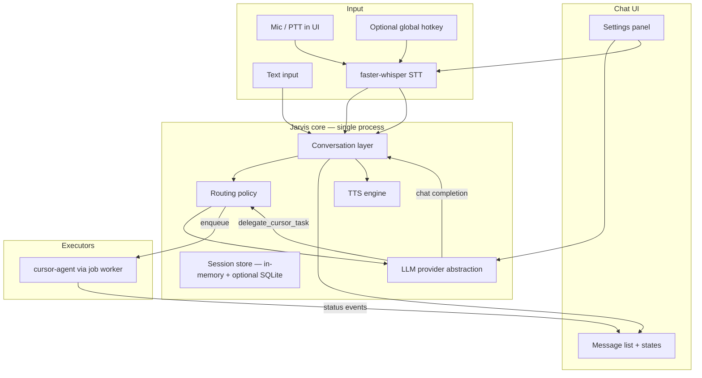
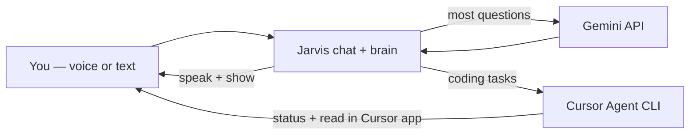

# Jarvis — Implementation Plan (Revised)

**Status:** Draft for review (supersedes prior “Jarvis V1 — voice-to-Cursor only” plan)  
**Product name:** Jarvis  
**Primary platform:** macOS (initial deployment and development)  
**Last updated:** 2026-10-18  

**Document history:** The earlier plan targeted a thin offline shell that sent every utterance to `cursor-agent` and spoke only status lines. This revision evolves Jarvis into a **conversational Mac assistant** that answers directly via a cloud LLM (Gemini first), speaks full responses, exposes a **chat UI**, and **delegates coding work to Cursor** when appropriate—while reusing existing voice, job, and Cursor modules where practical.

**Related docs:** `docs/ARCHITECTURE.md` describes the **current** Ollama-centric orchestrator and remains accurate for the **as-built** code until implementation catches up. This plan is the **target** architecture.

---

## 0. Repository audit (verified facts)

*Inspection date: 2026-10-18. Re-verify before implementation.*

### 0.1 What exists today

| Area | Verified state |
|------|----------------|
| **Package** | `offline-voice-orchestrator` (`pyproject.toml`), Python package `src/offline_voice/` |
| **CLI** | `offline-voice` → `daemon` (PTT loop), `run --text` (text-only), `check` (Ollama + cursor-agent) |
| **Conversation / LLM** | `llm/ollama_client.py` — local Ollama `/api/chat` with **tools** only; no Gemini; no chat UI |
| **Routing** | `router/agent_loop.py` — multi-round **Ollama tool-calling**; system prompt: “laptop voice orchestrator” |
| **Tools** | `tools/registry.py`: `list_projects`, `browser_open`, `app_open`, `cursor_run_task`, `shell_run` |
| **Cursor** | `tools/cursor.py` — `build_brief()`, `run_cursor_agent()` → `[binary, "-p", brief]`, `cwd=repo` |
| **Jobs** | `jobs/store.py` + `jobs/worker.py` — SQLite queue; async **cursor** jobs; completion notifies + TTS snippet in daemon |
| **Voice in** | `hotkey.py` (pynput hold-to-talk), `audio/capture.py` (sounddevice), `stt/whisper_engine.py` (faster-whisper) |
| **Voice out** | `tts/engine.py` — Piper (optional) + **pyttsx3** fallback; Piper playback uses **aplay/ffplay** (Linux-oriented) |
| **Config** | `config/settings.yaml`, `projects.yaml`, `policy.yaml`; dir: `OFFLINE_VOICE_CONFIG_DIR` or repo `config/` or `~/.config/offline-voice` |
| **Notifications** | `notify.py` — **`notify-send` only** (Linux); macOS falls back to print |
| **Chat UI** | **None** |
| **README** | **Not present** in repo |
| **Tests** | **No** `tests/` directory |

### 0.2 Reuse vs adapt vs replace vs defer

| Component | Recommendation | Rationale |
|-----------|----------------|-----------|
| `audio/capture.py`, `stt/whisper_engine.py` | **Retain** | Matches local STT requirement; macOS mic via PortAudio/sounddevice |
| `hotkey.py` | **Adapt** | Keep PTT model; document macOS **Accessibility** permission for global listener |
| `tts/engine.py` | **Adapt** | Keep abstraction; **macOS default: pyttsx3 (NSSpeechSynthesizer)**; fix Piper playback to use `afplay` on Darwin |
| `tools/cursor.py`, `build_brief` | **Retain** | Proven CLI invocation pattern; verify flags on Mac during Phase 0 |
| `jobs/store.py`, `jobs/worker.py` | **Retain** | Async Cursor delegation without blocking chat |
| `tools/registry.py` cursor path | **Adapt** | Expose `cursor_run_task` only via **explicit router/delegate** path—not every browser/shell tool to Gemini MVP |
| `router/agent_loop.py` + Ollama tools | **Replace** for MVP | Conversation uses **Gemini**; routing is **chat + optional delegate tool**, not full laptop orchestrator |
| `llm/ollama_client.py` | **Defer / optional later** | Useful for offline experiments; not MVP brain |
| `tools/browser.py`, `apps.py`, `shell_safe.py` | **Defer** | Out of MVP scope; risks shell/exec from chat; reintroduce only with strict policy |
| `daemon.py` (monolithic PTT→Ollama) | **Replace** | Split: **core conversation service** + UI + optional global hotkey client |
| `notify.py` | **Adapt** | Add macOS `osascript` notifications |
| `config.py` | **Adapt** | Add Gemini, UI, conversation paths; rename env prefix to `JARVIS_` over time |

### 0.3 Gaps vs target product

- No multi-turn **conversation state** or visible history  
- No **provider-agnostic LLM** layer or Gemini  
- No **intent routing** separating chat vs Cursor  
- No **desktop chat UI**  
- TTS does not speak **assistant answers** (daemon speaks Ollama reply or job snippets)  
- Linux-first ops (systemd, `notify-send`, `aplay`) in older plan and some code paths  
- **Cursor CLI contract** assumed as `-p <brief>` only—must be verified on macOS (`cursor-agent --help`)

### 0.4 Conflicts and risks in repository

| Conflict | Risk |
|----------|------|
| Plan previously said “remove Ollama”; repo **depends** on Ollama for `daemon`/`run` | MVP must introduce **parallel** conversation path; avoid breaking `check` until migrated |
| `AgentLoop` encourages **browser/shell** tools | Prompt injection + accidental exec if exposed to Gemini without gates |
| `cursor-agent` invocation not version-pinned | CLI changes can break delegation |
| No UI stack in dependencies | Must add one chosen framework (see §7) |
| Package still named `offline-voice-orchestrator` | User-facing rename to **Jarvis** is a Phase 0/1 doc + CLI alias decision |

---

## 1. Problem statement (revised)

Jarvis is a **conversational AI assistant for macOS** that you can use by **voice or text**, with **spoken replies** and a **simple chat window**. It handles everyday questions, explanations, and brainstorming **in conversation**. When a request clearly requires **repository work** (implement, debug, RCA in code, etc.), Jarvis **delegates to Cursor Agent** (CLI), which retains MCPs and repo integrations—without blocking the chat.

**MVP does not include:** long-term memory, wake word, smart home, autonomous background actions, or a multi-agent framework.

**Future:** Home Assistant and additional providers (see §16).

---

## 2. Design principles

| Principle | Implication |
|-----------|-------------|
| **One conversational brain** | Gemini (initial) powers replies and routing hints; not a swarm of agents |
| **Cursor for code** | Repo changes and tool-heavy dev work go to `cursor-agent`, async |
| **Same pipeline for voice and text** | STT → text → conversation engine → UI + TTS |
| **UI shows truth** | Full assistant text in chat even if TTS fails |
| **Offline where it matters for privacy/latency** | **STT local**; LLM requires network (Gemini) for MVP |
| **macOS-first** | Permissions, paths, TTS, notifications, launch agent—not systemd |
| **Simple permission model** | NL alone never authorizes shell, HA, or destructive Cursor work |
| **Evolve, don’t rewrite** | Reuse whisper, jobs, cursor runner, config patterns |

---

## 3. Scope

### 3.1 MVP (must ship)

- Multi-turn **conversation** with in-session context (no long-term memory)  
- **Gemini** via provider abstraction; API key from environment  
- **Routing:** conversational reply vs **delegate to Cursor** (single optional tool or equivalent structured action)  
- **Minimal chat UI** (macOS desktop): history, text input, send, mic/PTT, states, new conversation, basic settings  
- **TTS** of assistant messages (configurable engine; macOS-friendly default)  
- **Local STT** (faster-whisper); PTT in UI + optional **global hotkey**  
- Transcript **edit-before-send** after STT (simple text field pre-fill)  
- **Cursor jobs:** queue, status in UI (running/success/fail/timeout), link/hint to open Cursor  
- **projects.yaml** repo registry; explicit project selection or resolver to avoid wrong repo  
- Error handling: API, mic, STT, TTS, Cursor CLI  
- Clear conversation **clear / new chat** and local session storage  

### 3.2 Later enhancements (post-MVP)

- Stream tokens to UI  
- Tray icon, global push-to-talk without focusing UI  
- Ollama or OpenAI as extra providers  
- Session resume with Cursor CLI (if verified supported)  
- Deep link to Cursor chat tab (if verified)  
- Export/delete history; redaction tools  
- Re-enable guarded `browser_open` / `app_open` via explicit tool policy  

### 3.3 Future (explicitly out of MVP)

- **Home Assistant** integration (§16)  
- Wake word / always-on listening  
- Long-term memory / RAG across days  
- Linux/Windows parity (port after macOS MVP)  

---

## 4. Target architecture

### 4.1 Layered responsibilities



### 4.2 Conversation layer

**Owns:**

- Message list (user / assistant / system / tool-status)  
- Current session id and **rolling window** of messages sent to the model  
- Invoking LLM with system prompt + history  
- Applying routing outcome (plain reply vs start Cursor job)  
- Emitting UI events: `listening`, `transcribing`, `thinking`, `speaking`, `error`, `cursor_job_*`  

**Does not own:** Piper/Whisper weights, Gemini HTTP details, or subprocess management (delegated to adapters).

### 4.3 Routing strategy (no multi-agent MVP)

**Goal:** Distinguish (A) ordinary chat, (B) coding/repo tasks for Cursor, (C) future tool use—without multiple autonomous agents.

**Recommended approach: single LLM call with one optional function**

| Route | When | Action |
|-------|------|--------|
| **Chat** | Explanations, general knowledge, “what did we discuss”, brainstorming, clarifications | Model returns text only; no Cursor |
| **Delegate** | Implement/fix/debug in repo, RCA needing codebase/MCP, explicit “use Cursor”, “in my repo” | Model calls **`delegate_cursor_task`** with structured fields; core enqueues job |
| **Clarify** | Repo/task ambiguous | Model asks user; **no** delegate until project/instructions clear |

**Function schema (conceptual):**

- `project` (string, must match `projects.yaml` key)  
- `folder` (optional, default from registry)  
- `ticket` (optional string)  
- `instructions` (string)  
- `confirm_repo` (bool) — if true, UI shows confirmation card before enqueue (recommended when model confidence low)

**Guardrails (deterministic, outside model):**

- Delegate **rejected** if `project` unknown or `policy` denies  
- **No** `shell_run` or HA tools in MVP Gemini schema  
- User message alone cannot bypass confirmation if settings `cursor.require_confirmation: true`  
- Regex/heuristic **pre-check** optional: if message contains no code/repo cues and model requests delegate, log and require confirmation  

**Examples:**

| User | Expected route |
|------|----------------|
| “What is a hash map?” | Chat |
| “Help me understand this error” (+ paste) | Chat; may ask follow-ups |
| “What did we discuss a few messages ago?” | Chat (session history) |
| “Implement OAuth in billing-api under services/auth” | Delegate → `billing-api` |
| “Fix the failing test in my repo” | Clarify project → Delegate |

**Not used for MVP:** separate classifier model, planner agent, or Leon-style pulse.

### 4.4 Context and history limits

- **In-session only:** messages stored in SQLite or JSON under `~/Library/Application Support/Jarvis/sessions/` (macOS path; configurable).  
- **Window sent to Gemini:** last **40 messages** or estimated **~24k tokens** (whichever smaller)—trim oldest turns, keep system prompt.  
- **No summarization** in MVP when over limit; drop oldest with optional one-line system note: “Older messages omitted.”  
- **New conversation** clears in-memory thread; optionally archives previous session file.

---

## 5. LLM provider strategy

### 5.1 Initial provider: Google Gemini API

**Before implementation (Phase 0):** Confirm on [Google AI Studio](https://aistudio.google.com/) / Cloud docs:

- Model IDs available to your account (e.g. `gemini-2.0-flash`, `gemini-1.5-pro`)  
- **Rate limits** (RPM/RPD), especially free tier—limits **vary by model** and change over time  
- **Pricing** beyond free tier  
- **Data use / training** terms for API vs consumer apps—**do not assume** all Gemini endpoints share the same privacy posture  
- Context window size for chosen model  

**Design assumption for planning:** MVP uses **one configurable model id** (default: a current **Flash-class** model for latency/cost unless quality requires Pro).

### 5.2 Provider-agnostic interface

```text
LLMProvider (protocol / ABC)
  complete(messages, *, tools=None, temperature, max_tokens) -> CompletionResult
  health() -> bool   # optional ping

CompletionResult
  text: str | None
  tool_calls: list[ToolCall]
  raw: opaque (for logging redacted)
  usage: token counts if available
```

**Implementations:**

| Provider | Module (planned) | Status |
|----------|------------------|--------|
| `GeminiProvider` | `llm/gemini_provider.py` | MVP |
| `OpenAIProvider` | `llm/openai_provider.py` | Later |
| `OllamaProvider` | adapt existing `ollama_client.py` | Later / dev-only |

**Isolation:** Only provider modules import vendor SDKs (`google-genai` or `httpx` to REST). Conversation layer imports `LLMProvider` only.

### 5.3 Configuration and secrets

```yaml
# settings.yaml (excerpt)
llm:
  provider: gemini          # gemini | openai | ollama (future)
  model: "gemini-2.0-flash" # verify exact id at Phase 0
  timeout_seconds: 60
  max_output_tokens: 2048
```

**Secrets (never committed):**

- `JARVIS_GEMINI_API_KEY` or `GEMINI_API_KEY` (document one canonical name)  
- Load via environment or macOS Keychain wrapper (Phase 5 nice-to-have; MVP: env + `.env.example` without values)

### 5.4 Error handling

| Condition | Behavior |
|-----------|----------|
| HTTP 429 | User-visible “rate limited”; exponential backoff once; suggest wait |
| Timeout | Chat error bubble; retry button |
| Malformed JSON / empty candidates | Log redacted; “Model returned an invalid response” |
| Network offline | Distinguish from bad key; STT/local UI still works |
| Invalid API key | Settings screen error on `check` |

**Logging:** Never log full API keys or complete request bodies in production logs; redact `Authorization` headers.

### 5.5 Switching providers later

1. Set `llm.provider` and provider-specific env vars.  
2. Register provider in factory `build_llm_provider(settings)`.  
3. Adjust tool schema format if vendor differs (keep internal `ToolCall` normalized).  
4. Run provider contract tests with mocks.

### 5.6 Free tier and product implications

- Design for **rate limits**: queue or disable send while cooling down; show remaining quota only if API exposes it.  
- Avoid tight polling loops to Gemini.  
- **Cursor jobs** do not consume Gemini quota after delegate returns (only the planning turn does).  
- Document that **sensitive code** in chat may be sent to Google when using Gemini—offer future **local LLM** path for air-gapped use.

---

## 6. Conversational experience (MVP)

| Requirement | Implementation note |
|-------------|---------------------|
| Multi-turn | Session message list |
| Context | Trimmed history in §4.4 |
| Natural replies | System prompt: concise, helpful, ask clarifying questions |
| Follow-ups | Standard chat |
| Text + voice input | Same `ConversationService.handle_user_text` |
| Spoken responses | TTS after assistant message committed to UI |
| Visible history | Chat UI scroll area |
| States | `idle`, `listening`, `transcribing`, `thinking`, `speaking`, `error`, `cursor_running` |
| Stop speech | Cancel TTS queue / pyttsx3 stop (engine-specific) |
| New conversation | Button → new session id |
| No wake word | PTT only |

**System prompt (high level):** Jarvis persona; answer directly when possible; use `delegate_cursor_task` only for repo/coding work; never claim code was changed unless delegate completed; keep spoken-friendly sentence length in chat (UI shows full text).

---

## 7. Minimal chat UI (macOS)

### 7.1 Framework choice (after repo inspection)

**Current stack:** Python 3.11+, no frontend in repo.

**Recommended for MVP:** **NiceGUI** or **FastAPI + PyWebView**

| Option | Pros | Cons |
|--------|------|------|
| **NiceGUI** | Pure Python; fast chat layout; built-in async | Embeds web server; must bind localhost only |
| **FastAPI + PyWebView** | Native window; static HTML chat | Two layers to maintain |
| **Textual** | Terminal UI | Poor fit for “desktop assistant” |
| **Electron** | Rich UI | Heavy; new toolchain |

**Plan decision:** **NiceGUI** for MVP unless Phase 0 prototyping dislikes it—single language, async-friendly for STT/LLM/TTS/Cursor worker.

**Security:** Bind `127.0.0.1` only; no remote access; optional token on local API if needed.

### 7.2 UI elements

- Scrollable **conversation area** (user right-aligned or labeled roles)  
- **Text input** + Send (Enter)  
- **Microphone** button (hold or toggle for PTT in-window)  
- **Recording indicator** (pulsing icon / timer)  
- **Status bar:** Listening / Transcribing / Thinking / Speaking / Cursor job #id running  
- **Stop speaking** button  
- **New chat**  
- **Settings:** provider model, API key status (not value), STT model, TTS engine/voice, default project, global hotkey enable + key  
- **Cursor job card:** project, status, open log, “Focus Cursor” button (best effort)  
- **Errors:** inline banners for API/mic/STT  

### 7.3 Responsiveness

- LLM and STT run in **thread pool** or `asyncio.to_thread`—never block UI thread  
- Stream UI updates via NiceGUI callbacks / queues  
- Cursor jobs already backgrounded via `JobWorker`—subscribe to store changes  

**No separate backend service** unless NiceGUI’s in-process server is counted as internal (acceptable).

---

## 8. Voice input

| Requirement | Plan |
|-------------|------|
| Engine | Keep **faster-whisper** (`stt/whisper_engine.py`) |
| Mode | **Push-to-talk** (UI mic + optional global hotkey) |
| Global hotkey | `pynput` — macOS requires **Accessibility** → allow terminal/app |
| Permissions | macOS **Microphone** for app; document System Settings path |
| Max duration | `audio.max_record_seconds` (existing) |
| Empty STT | Show “Couldn’t hear anything”; no send |
| Wrong transcription | Show editable text field before send (user must confirm Send) |
| Wake word | **Out of MVP** |

**macOS note:** Test `sounddevice` default input device selection in settings.

---

## 9. Voice output

| Topic | Plan |
|-------|------|
| **What speaks** | Full **assistant** chat messages (option: skip code blocks; MVP speak entire reply or first N chars—setting `tts.max_chars`) |
| **Default on macOS** | **pyttsx3** (NSSpeechSynthesizer)—no extra model download |
| **Optional** | Piper with `afplay` for WAV on Darwin |
| **Configurable** | `tts.engine`: `macos` / `pyttsx3` / `piper` / `none` |
| **Decouple from LLM** | Message appended to UI first; TTS enqueued after |
| **New message while speaking** | **Stop** current playback; queue new or drop per setting (`tts.interrupt_on_new_message: true`) |
| **Stop button** | Calls `TTSEngine.stop()` — extend interface beyond `speak()` |
| **Failure** | Show “Playback failed”; chat text remains |

**Cursor completion:** Short spoken line optional (“Cursor finished”) **plus** job card in UI—not a substitute for conversational TTS.

---

## 10. Cursor Agent delegation

### 10.1 When to delegate

Per §4.3—coding, repo analysis, implementation, debugging, MCP-heavy RCA—not general knowledge questions.

### 10.2 Verified invocation (repository today)

```text
cursor-agent -p <brief>
working directory: repo root from projects.yaml
timeout: cursor.default_timeout_seconds (3600 in sample config)
```

**Phase 0 task:** On macOS dev machine, run `cursor-agent --help` and record supported flags (print mode, workspace, resume, output format). **Do not** plan features on unverified flags.

### 10.3 Preserve from existing code

- `build_brief()` structure (project, repo, folder, ticket, instructions, rules)  
- `JobStore` + `JobWorker` async execution  
- `projects.yaml` registry  
- Optional `OFFLINE_VOICE_DRY_RUN` → rename to `JARVIS_CURSOR_DRY_RUN`  

### 10.4 UX and safety

- UI shows **delegated** with job id, project, repo path, status  
- **Confirmation** before enqueue when setting enabled or project inferred  
- On complete: update card; **focus Cursor** via `osascript` (macOS); instruct user to read agent chat there  
- **Do not block** chat—user can keep talking; new messages go to Gemini while job runs  
- Wrong repo: require explicit `project` key match; show repo path in confirmation  
- Cursor’s own CLI/editor safeguards remain authoritative for file changes  

### 10.5 Prompt to Cursor (delegate brief)

Extend existing `build_brief` with Jarvis context line:

- Task originated from voice/chat session `{session_id}`  
- Put complete work product in Cursor agent chat  
- Optional `Title:` line for findability (retain from prior plan)

---

## 11. Safety and privacy

| Area | Safeguard |
|------|-----------|
| API keys | Env / Keychain; never commit; never log |
| Chat history | Local files under Application Support; user can clear/new chat |
| Logs | Redact keys; configurable log level; avoid logging full transcripts in prod |
| Microphone | Record only while PTT active; visible indicator |
| Gemini | User informed code/questions sent to Google; link to terms |
| Rate limits | Graceful degradation (§5.4) |
| Cursor file changes | Confirmation + visible repo path; dry-run mode for demos |
| Shell / arbitrary exec | **Disabled** in MVP Gemini tools |
| Prompt injection | Untrusted pasted content in user message must not auto-invoke delegate; confirmation + deterministic project match |
| Authorization | Natural language or model text ≠ permission; destructive Cursor requires explicit user confirm in UI when configured |

---

## 12. Smart home — future phase (not MVP)

**Leading candidate:** [Home Assistant](https://www.home-assistant.io/) as integration layer (verify APIs at implementation time).

**Boundary (future):**

```text
HomeAssistantAdapter (future)
  get_state(entity_id)
  call_service(domain, service, data)  # only after policy check
```

- Conversation layer calls adapter via **explicit tools** (`ha_call_service`), not raw HTTP from UI  
- **Authentication:** long-lived token in secrets store  
- **Confirmation:** scenes affecting security, locks, garage, etc.  
- **Extensibility:** new devices via HA config, not per-vendor code in Jarvis core  

No hardware or HA dependency for MVP.

---

## 13. macOS-first compatibility

| Linux-oriented item (current) | macOS-first guidance |
|------------------------------|----------------------|
| `notify-send` | `osascript` display notification or `UserNotifications` via pyobjc (later) |
| `aplay` / `ffplay` for Piper | **`afplay`** for WAV |
| systemd user unit | **`launchd`** `~/Library/LaunchAgents/ai.jarvis.plist` example in docs |
| `~/.config/offline-voice` | Prefer `~/Library/Application Support/Jarvis/` + optional `~/.config/jarvis` symlink |
| `wmctrl` / focus | **`osascript`** activate Cursor |
| Global hotkey | Accessibility permission documentation |

Cross-platform abstractions (`platform.system()`) only where cost is low.

---

## 14. Configuration (revised example)

```yaml
app:
  data_dir: "~/Library/Application Support/Jarvis"

hotkey:
  enabled: true
  hold_key: "f8"   # verify non-conflict on Mac keyboards

audio:
  sample_rate: 16000
  max_record_seconds: 120

stt:
  model: "base"
  device: "cpu"
  compute_type: "int8"
  language: "en"

llm:
  provider: gemini
  model: "gemini-2.0-flash"   # verify at Phase 0
  timeout_seconds: 60
  max_output_tokens: 2048

tts:
  engine: "pyttsx3"           # macOS default
  max_chars: 4000
  interrupt_on_new_message: true

conversation:
  max_messages: 40
  require_stt_confirm: true

cursor:
  binary: "cursor-agent"
  default_timeout_seconds: 3600
  require_confirmation: true
  focus_on_complete: true

notifications:
  enabled: true

ui:
  host: "127.0.0.1"
  port: 8765
```

`projects.yaml` — unchanged shape from repo.

**Environment:**

- `JARVIS_GEMINI_API_KEY` (required for MVP chat)  
- `JARVIS_CONFIG_DIR`, `JARVIS_CURSOR_DRY_RUN`  

---

## 15. Implementation roadmap

### Phase 0 — Repository and architecture audit

| Item | Detail |
|------|--------|
| **Objective** | Confirm facts, CLI contract, permissions, UI spike |
| **Components** | Docs, manual CLI checks, optional NiceGUI spike branch |
| **Dependencies** | Mac dev machine, Cursor CLI installed |
| **Tasks** | Verify `cursor-agent --help`; Gemini model + limits; list macOS permissions; decide NiceGUI vs PyWebView; archive decision log |
| **Risks** | CLI/docs drift; Gemini quota surprises |
| **Tests** | N/A |
| **Exit criteria** | Written CLI invoke spec; chosen UI stack; provider factory sketched; audit table signed off |

### Phase 1 — Conversational foundation

| Item | Detail |
|------|--------|
| **Objective** | Text-in/text-out multi-turn chat via Gemini |
| **Components** | `llm/provider.py`, `gemini_provider.py`, `conversation/service.py`, `conversation/session.py`, system prompt |
| **Dependencies** | Phase 0; `google-genai` or REST client |
| **Tasks** | Provider ABC; Gemini adapter; session trim; CLI `jarvis chat --text` REPL for dev |
| **Risks** | Tool-call format differences |
| **Tests** | Mocked provider; session trimming; error mapping 429/timeout |
| **Exit criteria** | Multi-turn CLI chat works with API key; no Cursor |

### Phase 2 — Minimal chat interface

| Item | Detail |
|------|--------|
| **Objective** | Desktop UI for messages, input, states, errors |
| **Components** | `ui/app.py`, settings panel stub |
| **Dependencies** | Phase 1 |
| **Tasks** | Message list; send; thinking indicator; new chat; settings load/save |
| **Risks** | Async race on rapid sends |
| **Tests** | UI state machine unit tests; manual Mac smoke |
| **Exit criteria** | Type message → see assistant reply in window |

### Phase 3 — Voice interaction

| Item | Detail |
|------|--------|
| **Objective** | PTT, STT, TTS integrated with same conversation pipeline |
| **Components** | Reuse `audio/`, `stt/`, `tts/`; extend TTS stop + macOS playback |
| **Dependencies** | Phase 2 |
| **Tasks** | Mic button; transcribe → edit → send; speak replies; stop speech; optional global hotkey |
| **Risks** | Mic permissions; TTS blocking |
| **Tests** | Empty audio; STT failure; TTS interrupt |
| **Exit criteria** | Speak → see text → hear reply; text path still works |

### Phase 4 — Cursor delegation

| Item | Detail |
|------|--------|
| **Objective** | Route coding tasks to Cursor; job lifecycle in UI |
| **Components** | Adapt `jobs/*`, `tools/cursor.py`; routing tool in Gemini; UI job card |
| **Dependencies** | Phase 1–3 |
| **Tasks** | `delegate_cursor_task` tool; wire worker; confirmation modal; macOS notify + focus |
| **Risks** | Wrong repo; long jobs |
| **Tests** | Mock cursor binary; routing tests (chat vs delegate); job state transitions |
| **Exit criteria** | “Implement X in project Y” enqueues job; general question does not; chat remains usable |

### Phase 5 — Reliability and daily use

| Item | Detail |
|------|--------|
| **Objective** | Packaging, permissions docs, logging, tests, launchd |
| **Dependencies** | Phase 4 |
| **Tasks** | `jarvis check`; README; rename CLI; `.env.example`; pytest CI; log redaction |
| **Risks** | Dependency weight (whisper, nicegui) |
| **Tests** | Full matrix §16; E2E manual script |
| **Exit criteria** | MVP acceptance §17 met on macOS |

### Future phases

- Home Assistant (§12)  
- Long-term memory  
- Wake word  
- Streaming audio / advanced UX  
- Additional LLM providers  
- Linux parity for notifications/TTS paths  

---

## 16. Testing strategy

| Category | Tests |
|----------|-------|
| Provider factory | Select gemini vs future openai |
| Conversation session | Trim at max_messages; new session isolation |
| Routing | Mock Gemini returning text only vs tool call |
| API errors | 429, timeout, malformed body |
| STT | Empty transcript; handler does not send |
| TTS | Failure does not remove chat message; stop() cancels |
| UI states | listening → transcribing → thinking → speaking |
| Cursor | Job enqueue from tool; mock script exit 0/1; timeout |
| Negative | “What is a hash map?” does **not** spawn cursor subprocess |
| Positive | “Fix tests in demo-repo” **does** enqueue with correct cwd |
| Secrets | Logs do not contain `AIza` patterns in CI grep test |
| E2E manual (macOS) | Text chat; voice round-trip; delegate sample repo |

**Tooling:** `pytest`, `httpx` mock, `unittest.mock` for subprocess.

---

## 17. MVP acceptance criteria

1. User can **type** a multi-turn message and receive **context-aware** Gemini replies in the chat UI.  
2. User can **PTT**, see transcription (editable), send, and **hear** the assistant response via TTS.  
3. **“What is a hash map?”** answered in chat **without** Cursor subprocess.  
4. **“Implement … in &lt;project&gt;”** triggers delegate flow, shows **running → done/fail**, does not freeze chat.  
5. API key from env only; `jarvis check` fails clearly if missing.  
6. User can start **new conversation** and clear visible history.  
7. Stop speech works; chat still shows full text if TTS fails.  
8. Documented macOS mic + Accessibility steps for global hotkey (if enabled).

---

## 18. Risks and mitigations (consolidated)

| Risk | Mitigation |
|------|------------|
| Gemini free tier limits | Backoff, user messaging, model choice |
| Sending secrets to cloud | User warning; future local LLM |
| Cursor CLI changes | Configurable argv template; Phase 0 audit |
| Ollama code path confusion | Deprecate `daemon` as primary; document migration |
| Tool/schema injection | Narrow MVP tools; confirmation gates |
| NiceGUI security | Localhost bind only |
| Whisper CPU slow | Configurable model size; progress UI |

---

## 19. Open decisions (reviewer)

1. **UI framework:** NiceGUI vs FastAPI+PyWebView (plan recommends NiceGUI).  
2. **Package rename:** `jarvis` CLI vs keep `offline-voice` alias.  
3. **Default Gemini model id** after Phase 0 verification.  
4. **TTS default:** pyttsx3 only vs Piper optional download.  
5. **Cursor confirmation:** always on vs off by default (plan: **on**).  
6. **Speak full reply vs truncated** for long markdown (default cap?).  
7. **Retain Ollama `daemon` command** for power users or remove in Phase 5?

---

## 20. Architecture diagram (user mental model)



---

*End of revised plan. No implementation until approved. Update `docs/ARCHITECTURE.md` during Phase 1 to match this document.*
